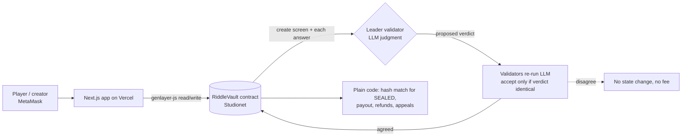

# RiddleVault

**Lock a prize behind a riddle. Let an AI jury crack the verdict.**

RiddleVault is a GenLayer intelligent contract plus a vault-door themed web app. A creator locks points behind a riddle or
creative challenge. Players pay a small fee per answer; GenLayer validators judge every answer **by consensus** (SOLVED /
PARTIAL / WRONG, a score and written reasoning that stays public). The first SOLVED answer takes the vault. Rejected answers can be
appealed with a bond, and a vault nobody solves refunds everyone.

* Live app: https://riddlevault.vercel.app
* Contract (Studionet): `0xaadC5cd5e5067CBA6892AC12839747157D31d9F8`
* Network: GenLayer **Studionet** (chain 61999, gasless). Points only, no real money.
* Contract: `contracts/riddlevault.py` · Trust model: [`docs/TRUST_MODEL.md`](docs/TRUST_MODEL.md)

## Why GenLayer

The hard question here is *"does this free-text answer satisfy this written standard?"* That is subjective, non-deterministic
judgment, so none of the usual tools fit:

* **Oracles (Chainlink, Pyth)** deliver objective data from known sources. There is no feed for "is this a valid solution".
* **A normal smart contract** can only compare exact values (we use that for `SEALED` mode's hash match, and nowhere else).
* **The creator or an admin as judge** would be the party who profits from rejecting solvers.
* **One AI API** means one operator and one model decide who wins, with nothing on-chain to agree on or challenge.

On GenLayer each validator runs its own LLM on the same locked criteria and the network only accepts a verdict that validators
reproduce (equivalence principle via `gl.vm.run_nondet_unsafe`: the leader proposes, every validator re-runs and must reach the identical
SOLVED / PARTIAL / WRONG). AI is used only for judgment; the verdict and score are computed deterministically from per-criterion
true/false flags, and money rules are plain contract code.

## Architecture



## How a vault works

1. **Forge.** The creator writes the riddle, 2-6 objective acceptance criteria, prize, attempt fee, limits and a deadline.
   An AI screen rejects vague, subjective, unjudgeable or trivially guessable riddles *before* any points are locked. Everything is then
   welded shut: there is no edit, cancel or withdraw for the creator.
2. **Crack.** Players submit answers (limited per player and per vault). Each costs the attempt fee, which goes into the pot.
3. **Judge.** Validators check each criterion independently; the contract derives the verdict from those checks (all met = SOLVED,
   at least half = PARTIAL, else WRONG). Validators must agree on the verdict or nothing is recorded (and nothing is charged).
4. **Win.** First SOLVED takes `prize + all fees + forfeited bonds`.
5. **Appeal.** In rubric mode a player can appeal a PARTIAL/WRONG answer with a bond to a stricter, fresh panel. Overturned: bond back and
   the vault is theirs. Upheld: the bond joins the pot.
6. **Expire.** If nobody solves it, anyone can close the vault: prize back to the creator, every fee and bond refunded to players.

### Two modes

| | `RUBRIC` (open rubric) | `SEALED` (sealed hash) |
|---|---|---|
| Secret? | none, criteria are public | creator commits `sha256(nonce \| normalized answer)`; the answer never goes on-chain |
| Who can say SOLVED | the validator jury | only the contract, by exact hash match |
| AI knows the secret? | n/a | **never**, so it cannot leak it |
| Appeal | yes | no (nothing to reconsider) |
| Best for | creative tasks, many valid answers | one exact answer (use a long or unusual one) |

## Trust model (summary)

Full version: [`docs/TRUST_MODEL.md`](docs/TRUST_MODEL.md).

* **Locked terms.** Riddle, criteria, prize, fee, limits and deadline cannot change after creation. The creator cannot cancel, withdraw or play their own vault.
* **Judgment sources.** (1) an AI creation screen, (2) the validator jury for each answer, (3) a plain hash comparison in sealed mode. Never the creator.
* **Agreement.** Validators re-run the judgment independently and accept the leader only on an identical verdict (only the verdict is compared; stored checks, score and reasoning are the leader's). They report per-criterion true/false; the contract computes verdict and score.
* **Disagreement.** No agreement means no state change and no fee. Malformed model output reverts. Players can appeal, and GenLayer's protocol-level appeal also applies.
* **Leakage.** Sealed vaults store only a hash and the AI never sees the secret. Honest tradeoff: a short guessable answer can be brute-forced from the hash.
* **No profit from dead vaults.** On expiry the creator only gets their own prize back; players get every fee back.
* **Residual risks** (documented, not hidden): LLM inconsistency on borderline answers, answer front-running, creator self-play with a second wallet, Sybil spam with free points, prompt injection (including via the appeal argument), public reasoning hinting at rubric solutions, validator collusion, test-network trust.

## Repo layout

```
contracts/riddlevault.py     intelligent contract
tests/direct/                pytest direct-mode tests (LLM mocked)
scripts/                     deploy + real Studionet end-to-end run (genlayer-js 1.1.8)
deployments/                 studionet.json (address) and e2e-studionet.json (e2e log with tx hashes)
frontend/                    Next.js 16 + Tailwind 4 app (vault list, forge, vault detail, leaderboard, trust)
docs/TRUST_MODEL.md          trust model
.github/workflows/ci.yml     lint + tests + frontend build
```

## Contract API

Writes: `claim_points`, `create_vault`, `submit_answer`, `appeal_attempt`, `expire`, `reveal_answer`.
Views: `get_vault`, `get_vaults(status, offset, limit)`, `get_attempts`, `get_user`, `get_leaderboard`, `get_stats`, `get_config`.

## Develop

```bash
# contract
pip install -r requirements.txt
genvm-lint check contracts/riddlevault.py
pytest tests/direct/ -q

# frontend checks
cd frontend && npm install && npm run lint && npm run build && cd ..

# deploy + e2e (needs a funded-by-nothing Studionet key in .env, see .env.example)
npm install
npm run deploy:studionet
npm run e2e:studionet

# frontend
cd frontend && npm install
cp .env.example .env.local   # set NEXT_PUBLIC_CONTRACT_ADDRESS
npm run dev
```

The sealed-answer hash is computed in the browser (`frontend/lib/seal.ts`) and must match `answer_digest` in the contract:
`sha256(nonce + "|" + normalized answer)` where normalization lowercases and keeps letters and digits separated by single spaces.

## Deployment

See `deployments/studionet.json` for the current Studionet contract address and `deployments/e2e-studionet.json` for the full
on-chain end-to-end log. Studionet state is temporary and may be reset; redeploy with `npm run deploy:studionet` if so.

MIT licensed.
